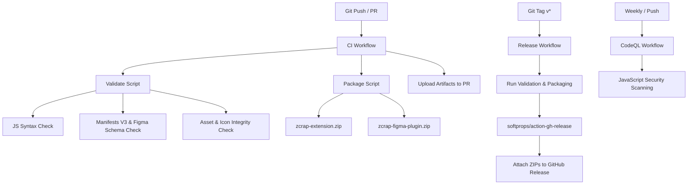

# GitHub CI/CD Automation Suite Implementation Plan

> **For agentic workers:** REQUIRED SUB-SKILL: Use superpowers:subagent-driven-development to implement this plan task-by-task. Steps use checkbox (`- [ ]`) syntax for tracking.

**Goal:** Implement robust, zero-external-dependency GitHub CI/CD workflows for Zcrap covering lint/manifest validation, automated release packaging, and CodeQL security analysis.

**Architecture:**
A dual-target repository (Chrome Extension + Figma Plugin) supported by native Node.js validation (`scripts/validate.js`) and cross-platform packaging (`scripts/package.js`), tied together with GitHub Actions workflows (`ci.yml`, `release.yml`, and `codeql.yml`).

**Architecture Diagram:**

---

## Tasks

### Task 1: Create Validation Engine (`scripts/validate.js`)
- [x] Create `scripts/validate.js` using Node.js standard library (`fs`, `path`, `vm`).
- [x] Validate JavaScript syntax for `background.js`, `content.js`, `popup.js`, `code.js`.
- [x] Validate `extension/manifest.json` and `figma-plugin/manifest.json` schemas and verify all referenced files exist.
- [x] Run `node scripts/validate.js` locally to verify all checks pass.

### Task 2: Create Cross-Platform Packaging Engine (`scripts/package.js`)
- [x] Create `scripts/package.js` that bundles `extension/` and `figma-plugin/` into `dist/`.
- [x] Support both Windows (PowerShell `Compress-Archive`) and Linux/macOS (`zip`).
- [x] Run `node scripts/package.js` locally and verify generated zip archives in `dist/`.

### Task 3: Root `package.json` Configuration
- [x] Create minimal root `package.json` with scripts `npm run validate` and `npm run package`.
- [x] Update `.gitignore` to ignore `dist/` and any packaging artifacts.

### Task 4: GitHub Actions Workflows
- [x] Create `.github/workflows/ci.yml` for pull requests and main pushes with test artifact upload.
- [x] Create `.github/workflows/release.yml` for tag pushes (`v*`) with automated release generation.
- [x] Create `.github/workflows/codeql.yml` for weekly and PR security scanning.

### Task 5: End-to-End Verification
- [x] Run `npm run validate` and `npm run package` locally.
- [x] Verify workflow YAML syntax and ensure all paths and action versions are up to date.
- [x] Update `README.md` with CI badge and build/release instructions.
